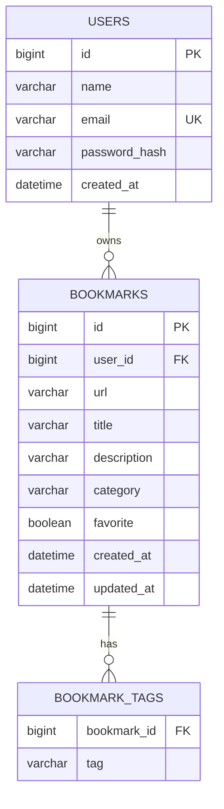

# 🔗 LinkVault: Smart Bookmark Manager

LinkVault is a full stack web application for saving, organising and finding website links. Save a URL with a title, description, category and tags, then search, filter, sort and favorite your bookmarks. Every user gets a private vault protected by JWT authentication.

> Full Stack Development course project, built with **React**, **Spring Boot** and **MySQL**.


---

## 📸 Screenshots

| Dashboard | Add / edit bookmark |
|---|---|
|  |  |

| Search and filters | Dark mode |
|---|---|
|  |  |

| Login | Database (MySQL) |
|---|---|
|  |  |

---

## ✨ Features

**Bookmark management**
- Save a bookmark with URL, title, description, category and tags
- Edit and delete bookmarks
- **Auto-fetch details:** paste a URL and the title and description are read from the page
- Duplicate URL detection

**Finding things**
- Search across title, description, URL and tags (debounced, so it doesn't call the server on every keystroke)
- Filter by category, by tag, or by favorites
- Tag cloud in the sidebar with bookmark counts
- Sort by newest, oldest or title (A–Z / Z–A)
- Server-side pagination

**Accounts and security**
- Register and log in with email and password
- Passwords hashed with **BCrypt**
- Stateless authentication with **JWT**
- Each user can only see and change their own bookmarks

**User experience**
- Dark mode and responsive layout
- Instant favorite toggle that rolls back if the request fails
- Validation on both client and server, with clear error toasts

---

## 🛠️ Tech Stack

| Layer | Technology |
|---|---|
| Frontend | React 18, Vite, React Router, Axios, react-hot-toast |
| Backend | Java, Spring Boot 3.2, Spring Web, Spring Data JPA, Spring Security, Bean Validation |
| Database | MySQL 8 |
| Auth | JWT (jjwt), BCrypt |
| Other | Jsoup (page metadata), JUnit 5 |

---

## 🏗️ Architecture

```
┌──────────────┐   HTTP + JSON    ┌──────────────────────────┐        ┌─────────┐
│  React app   │ ───────────────► │  Spring Boot REST API    │ ─────► │  MySQL  │
│  (Vite 5173) │ ◄─────────────── │  (port 8080)             │ ◄───── │         │
└──────────────┘   JWT in header  └──────────────────────────┘  JPA   └─────────┘
```

The backend uses a layered design: **Controller → Service → Repository → Database**. A JWT filter authenticates each request, and a global exception handler returns every error as `{ "message": "..." }`.

### Database design



---

## 📁 Project Structure

```
LinkVault/
├── client/                      # React frontend
│   └── src/
│       ├── api/                 # axios instance + all API calls (services.js)
│       ├── components/          # BookmarkCard, BookmarkForm, FilterSidebar, ...
│       ├── context/             # AuthContext (login state + JWT)
│       ├── hooks/               # useDebounce
│       └── pages/               # Login, Register, Dashboard
└── server/                      # Spring Boot backend
    └── src/main/java/com/linkvault/
        ├── config/              # SecurityConfig (JWT, CORS)
        ├── controller/          # Auth, Bookmark and Tag endpoints
        ├── dto/                 # request/response objects
        ├── entity/              # User, Bookmark
        ├── exception/           # ApiException, GlobalExceptionHandler
        ├── repository/          # Spring Data JPA repositories
        ├── security/            # JwtUtil, JwtAuthFilter
        └── service/             # business logic
```

---

## 🚀 Getting Started

### Prerequisites

- **JDK 17 or newer** (`java -version`)
- **Maven 3.9+** (`mvn -v`)
- **Node.js 18+** (`node -v`)
- **MySQL 8** running on `localhost:3306`

### 1. Clone the repository

```bash
git clone https://github.com/ArPiT-1310/LinkVault.git
cd LinkVault
```

### 2. Configure and start the backend

Create a file named `.env` inside the `server` folder (next to `pom.xml`):

```
DB_USERNAME=root
DB_PASSWORD=your_mysql_password
JWT_SECRET=any-long-random-string-of-at-least-32-characters
```

Then run:

```bash
cd server
mvn spring-boot:run
```

The API starts at **http://localhost:8080**. The `linkvault` database and all tables are created automatically on first run, so you don't need to create anything in MySQL.

### 3. Start the frontend

Open a second terminal:

```bash
cd client
npm install
npm run dev
```

Open **http://localhost:5173**, create an account and start saving links. In development, Vite forwards `/api` requests to the backend, so no extra CORS setup is needed.

### Environment variables

| Variable | Where | Purpose | Default |
|---|---|---|---|
| `DB_USERNAME` | server `.env` | MySQL username | `root` |
| `DB_PASSWORD` | server `.env` | MySQL password | none, set this |
| `JWT_SECRET` | server `.env` | Token signing key (32+ characters) | placeholder, change it |
| `CORS_ORIGINS` | server `.env` | Allowed frontend origins, comma-separated | `http://localhost:5173` |
| `VITE_API_URL` | client `.env` | API base URL, needed only when deployed | `/api` |

---

## 📡 API Reference

All endpoints except `/api/auth/*` need the header `Authorization: Bearer <token>`.

| Method | Endpoint | Description |
|---|---|---|
| POST | `/api/auth/register` | Create an account, returns a token |
| POST | `/api/auth/login` | Log in, returns a token |
| GET | `/api/bookmarks` | List bookmarks (supports filters, sorting, paging) |
| POST | `/api/bookmarks` | Create a bookmark |
| PUT | `/api/bookmarks/{id}` | Update a bookmark |
| DELETE | `/api/bookmarks/{id}` | Delete a bookmark |
| PATCH | `/api/bookmarks/{id}/favorite` | Toggle favorite |
| GET | `/api/bookmarks/meta?url=` | Read a page's title and description |
| GET | `/api/tags` | All tags with counts |

**List query parameters:** `search`, `category`, `tag`, `favorite`, `sort` (e.g. `createdAt,desc`), `page`, `size`

**Example**

```bash
# Log in
curl -X POST http://localhost:8080/api/auth/login \
  -H "Content-Type: application/json" \
  -d '{"email":"demo@linkvault.com","password":"secret1"}'

# Search favorites tagged "docs"
curl "http://localhost:8080/api/bookmarks?search=spring&tag=docs&favorite=true&page=0&size=10" \
  -H "Authorization: Bearer <token>"
```

---

## 🧪 Running Tests

```bash
cd server
mvn test
```

---

## 🔒 Security Notes

- Passwords are never stored in plain text; only BCrypt hashes are saved.
- Every bookmark query is scoped to the logged-in user, so users cannot access each other's data.
- The metadata fetcher only accepts public `http(s)` addresses, so it cannot be used to reach internal services.
- Secrets live in a `.env` file that is excluded from version control.

---

## 🔮 Future Improvements

- Import and export bookmarks as JSON
- Broken-link checker
- Shared and public collections
- Browser extension for one-click saving
- Deployment with Docker

---

## 👤 Author

**[Your Name]** · USN: [Your USN]
[Your College / Department]
GitHub: [@ArPiT-1310](https://github.com/ArPiT-1310)

---

## 📄 License

This project was created for educational purposes as part of a Full Stack Development course.